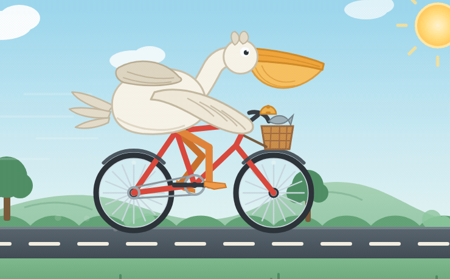

# 鹈鹕骑自行车 · SVG 2D 动画

> **在线演示 (GitHub Pages)**: [https://elavita.github.io/pelican-bicycle/](https://elavita.github.io/pelican-bicycle/)  
> 主产物：[pelican-bicycle.html](pelican-bicycle.html)（首页入口 [index.html](index.html)）—— 单文件纯前端，双击离线可开，无外部依赖、无网络请求。

## 动画效果预览 (GIF)



*主体特写动图：[pelican-bicycle-focus.gif](pelican-bicycle-focus.gif) | 全景完整动图：[pelican-bicycle.gif](pelican-bicycle.gif)*

## 画面

960×540 的 SVG 场景：一只鹈鹕骑红色自行车在公路上行驶，远山 / 树丛 / 路面虚线 / 前景草丛按不同速度分层视差滚动。
鹈鹕有标志性的大喙 + 喉囊、脖子带 S 形弯曲、一只翅膀搭在车把上、另一只在背后拍打；前筐里装着一条鱼。

## 动画是怎么连起来的

只有一个状态源：世界前进距离 `dist`（像素）。

```
轮角   = dist / 轮半径(62)
曲柄角 = 轮角 / 传动比(2.6)
踏板   = 中轴(430,355) + 曲柄长(24) × 曲柄角
腿     = 两骨 IK（髋(400,262) + 大腿62 + 小腿62 → 求膝），目标就是踏板
```

所以"腿在蹬"和"轮在转"不可能脱节——不存在滑步。起伏、点头、喉囊鼓动都挂在曲柄相位上；翅膀拍打和眨眼挂在时间上。

## 交互

播放/暂停、速度滑杆（0–420 px/s，读数按 120px = 1m 换算成 km/h）、显示骨架（显示髋/膝/踝关节与曲柄圆，用来验证 IK）、按铃（WebAudio 小 ding + 铃身振动）。
快捷键：`空格` 播放/暂停、`←` `→` 调速、`B` 按铃、`K` 骨架。
系统开了"减少动态效果"时默认以暂停启动。

## 已验证（都是实测，不是推断）

页内自检：打开 `pelican-bicycle.html?selftest=1&paused=1`，结果写在页面底部 `<pre id="selftest">`。
判据读的是**渲染后的真实 DOM 属性**（位置用 `getScreenCTM()` 换算回 viewBox 用户单位），不是作者意图。当前 **24/24 通过**：

| 判据 | 实测值 |
|---|---|
| A1 脚贴踏板（扫 360 个曲柄角） | maxErr = 0.000px，脱靶 0/360 |
| A2 膝轨迹有行程 | x 行程 32.1px，y 行程 42.4px |
| A3 膝盖朝前（不反关节） | 反关节帧 0/360 |
| B1 轮角由 dist 决定 | 6 个 dist 样本全对 |
| B2 曲柄臂长恒定 | 6/6 |
| B3 脚跟着踏板走 | 6/6 |
| B4 腿姿态按曲柄周期复现 | 周期 1013px；半周期姿态不同 |
| C1 前进会改变轮与腿 | Δdist=90px 后属性已变 |
| D1 属性无 NaN/undefined | clean（23 个元素 × 6 个属性） |
| E1 视差平移在瓦片周期内 | clouds 886.0 / farHills 762.6 / nearScenery 441.7 / foreground 463.9 |
| E2 灌木瓦片接缝连续 | y(0)=422 = y(960)=422 |
| F1 速度读数与状态一致 | 300 px/s → 9.0 km/h |
| G1 喉囊在鼓动 | 缩放行程 0.216（0.89 → 1.11） |
| G2 身体随蹬踏起伏 | 行程 6.06px |
| G3 翅膀在拍打 | 角度行程 14.00° |
| H1 太阳光芒确有 CSS 动画 | animationName=sunspin, duration=70s |
| I1 尘土留在自身轨迹包络内 | 18 个采样 0 越界；样本 (300,428) (253,410) (205,409) |
| I2 两轮始终贴地（起伏不抬整车） | 7 个相位的后轮接地点 y 全为 430.00 |
| I3 脚掌压在踏板上 | rot −0.3°/−8.1°/6.2°，脚中心离踏板中心 10.0px |
| I4 翅膀与蹬踏耦合 | dist 固定时"仍在拍"的采样 0/9；行进行程 13.4° |
| I5 图层顺序正确 | 速度线 / 尘土 / 近侧大腿 / 鱼 均在正确图层 |
| I9 音频不可用时按铃仍有视觉反馈 | 注入抛异常的 AudioContext 后 `#bell` 仍写入 transform |
| I10 眼皮盖得住眼白 | 眼皮 20×30 vs 眼白 16×16 |
| I11 挡泥板与轮毂同心 | 后弧 r=70 端点到轮毂 70.0/70.0；前弧同 |

### 变异测试（证明断言真的会红）

`node tools/mutation_test.mjs`（在任务文件夹内跑，需要本机 Chrome）。18 个变异体，每个破坏一个功能，**全部被抓到**：

| 变异 | 抓到它的判据 |
|---|---|
| 膝盖选反解 | A3 |
| 后轮不再旋转 | B1, C1 |
| 腿改短到够不到踏板 | A1, A2, B3 |
| 大腿不更新（僵腿） | B4, C1 |
| 视差不做周期取模 | E1 |
| 灌木周期不整除瓦片宽 | E2 |
| 速度读数不再更新 | F1 |
| 脚钉死不跟踏板 | B3 |
| 喉囊摆动写死为常数 | G1 |
| 太阳光芒只留 reduced-motion 例外、不定义动画 | H1 |
| 尘土 scale 绕 SVG 原点（飞到天空/山丘） | I1 |
| 起伏作用到整车（轮子被抬离地面） | I2, G2 |
| 脚掌按小腿整轴旋转（吊在踏板下） | I3 |
| 翅膀改回墙钟时间驱动（停车仍拍翅） | I4, G3 |
| 鱼画在筐前壁之后（摆在筐盖上） | I5 |
| 铃的抖动被音频成功门控 | I9 |
| 眼皮只有 6px 高 | I10 |
| 挡泥板弧心偏离轮毂 6px | I11 |

> M16 的第一版**不忠实**：把 `bellShake()` 挪进 try 的第一行，音频失败前它已经执行过了，等于没复现原 bug，断言"漏检"。改成"视觉反馈被音频成功门控"后才变红。变异体不忠实比断言无效更隐蔽。

过程中修掉的三个真实漏洞（都是"全绿但断言无效"或"配置没人读"）：

1. **B1 原本抓不到"后轮根本不旋转"**：属性缺失时 `num('')` 得 NaN，而 `NaN > 0.05` 恒为 false，判据静默放过。已加 `Number.isFinite` 显式判定，重跑变异体后 B1 变红。
2. **A3 原本不存在**：第一版没有任何判据检查膝盖朝向，把 IK 的解选反（反关节）也能全绿。补了叉积符号判据。
3. **太阳光芒的 CSS 动画根本没定义**：CSS 里只写了 `@media (prefers-reduced-motion){ .sun-rays{animation:none} }`，却没有任何 `animation` 规则——光芒其实从不转。补了 `#sunRays` 的 70s 自转 + 对应判据 H1 + 变异体 M10。

### 动画确实在推进（差分证据）

- `?dist=506&paused=1`：virtual-time-budget 500 与 3000 两次读数都是 `dist 506px`（暂停时状态不动）。
- 不加 `paused`：同样两次读数分别是 `dist 7px`、`dist 15px`（状态在动）。
- 同一 URL 在 budget 1000 / 4000 / 8000 下截三帧，MD5 互不相同（`e3a09a28…` / `c1ab84b2…` / `921b3695…`）。

> 注意：headless `--dump-dom` 的快照时刻与 budget 不成正比（budget 8000 那次读到 dist 9px）。所以"推进"的证据用差分（暂停 vs 不暂停）和三帧不同哈希，不用"budget 越大 dist 越大"。

### 文件编码

UTF-8 无 BOM（首三字节 `60 33 68` = `<!d`），LF 换行（CRLF 行数 0）。

## 独立审计（结论详见 [AUDIT.md](AUDIT.md)）

审计由新会话 subagent 做，只拿到产物与验收标准，不给它写作者的推理。**审计时页内自检已经全绿，审计仍然抓到 13 个问题**，其中 10 个是确定 bug（尘土飞到天空、起伏把轮子抬离地面、脚吊在踏板下方、大腿根盖在腹部上、停车翅膀仍拍、速度线压在尾羽上、鱼摆在筐盖上、眼皮盖不住眼、挡泥板不同心、无音频时按铃无反馈）。

处理：10 个 bug 全部修复，每个配一条回归断言（I1–I11）和一个对应变异体（M11–M18）；3 个主观项（车座被身体盖住、头冠形状、筐支架）做了视觉处理但**没有断言**——按约定不为"配置存在"写断言。

审计者还独立佐证了 IK：按 `dist=0` 手算得膝 (453.7, 292.8)，页面 readout 报 `knee (454, 293)`。

## 未验证 / 已知限制

- **跨浏览器**：只在 headless Chrome 上验证过。没测 Firefox / Safari。用到的特性都是常规项（CSS 渐变、SVG `<use href>`、`requestAnimationFrame`、WebAudio、`getScreenCTM`），但没实测。
- **帧率与流畅度**：没做 fps 测量。每帧写约 25 个属性 + 4 个视差组，场景很小，肉眼观察无卡顿，但没有数字。**headless 的 rAF 被虚拟时钟节流，测不出真实帧率**——审计者也独立指出了这一点。
- **真实指针交互**：按钮与 SVG 铃是用合成事件驱动的。滑块拖拽、hover 样式、点击热区（铃只有 26×13 的命中区）未测。
- **`prefers-reduced-motion` 分支**：代码与 CSS 都在，但没有模拟该媒体查询，"默认不自动跑"未实测。
- **窄窗口 / 响应式**：只在 1120×880 下截图，HUD 换行与卡片在 400px 宽下的表现未看。
- **长跑数值漂移**：`dist` 无上限累加，轮角会到几万度；未测 `dist > 1e6` 时的精度与 `stroke-dashoffset` 的大数行为。
- **蹬踏力学合理性**：只验证了几何（脚贴踏板、膝不反关节、姿态按周期复现），没判断"哪只脚在做发力行程、回程是否合理"。
- **观感**：构图是卡通风格，不是解剖学正确——鹈鹕的腿从身体下方伸出、翅膀当手扶车把，都是刻意的卡通化处理。审计抓到的 3 个主观项（车座被身体盖住、头冠、筐支架）已做视觉处理但没有断言。
- **速度换算**：`120px = 1m` 是为了让读数看起来合理而选的场景比例，不是真实世界标定。
- **传动比 2.6** 是审美参数，没有任何判据约束它（改成一个荒谬的值不会让测试变红）——这是有意的：它不是正确性属性。
- **无障碍**：SVG 有 `role="img"` / `title` / `desc`；暂停即静态画面，但没有独立的"静态替代画面"。
- **音频**：只在用户点击车铃时发声，不自动播放；无音频环境会静默 catch（已断言：此时视觉反馈仍在）。

## 调试参数（正常运行不需要）

`?dist=N` 固定相位 · `?paused=1` 启动即暂停 · `?speed=300` 预设速度 · `?skel=1` 骨架层 · `?bare=1` 去掉页面外壳只留画面 · `?view=x,y,w,h` 局部放大 · `?selftest=1` 页内自检。

> 这些参数曾经埋过一个坑：`paused` 的布尔判断写成 `q.get('paused') !== '0'`，`paused=1` 反而变成"播放"，导致前几轮"固定相位截图"其实都在跑。已修（`=== '0'`），并重新取证。

## 目录

- `pelican-bicycle.html` —— 主产物（50 KB，UTF-8 无 BOM，LF，0 处外部引用）
- `tools/mutation_test.mjs` —— 变异测试脚本（需要本机 Chrome；判据与页内自检同源）
- `preview/` —— **修复后**的 headless Chrome 截图证据（4 个相位 + 头部特写 + 腿脚特写 + 高速帧）
- `audit-evidence/` —— 审计者自己截的**修复前**截图与测量脚本，记录的是已被修掉的缺陷
- [AUDIT.md](AUDIT.md) —— 独立审计结论与逐条处理
